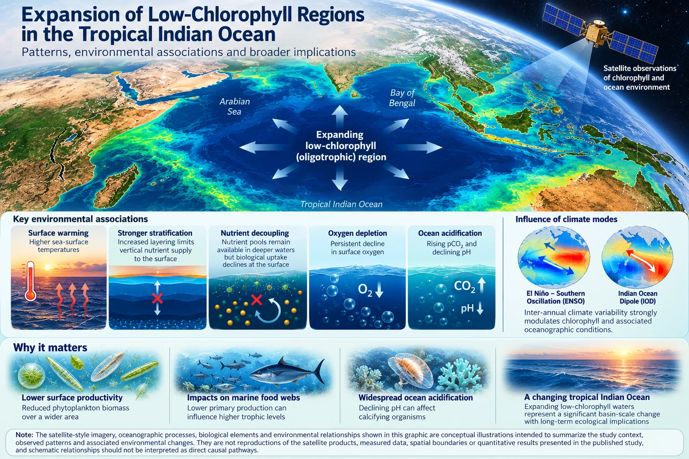

::: {.panel .reading}
[Reading this carefully]{.panel-title}

Shows
:   Changes in the spatial extent of low-chlorophyll waters during 2015–2024, with physical and biogeochemical changes occurring alongside.

Doesn’t show
:   Established causal pathways. Associations are not mechanisms, and interannual climate modes overlap the study period.

Connected to
:   Surface warming and stratification, nutrient supply to the surface, monsoon circulation and freshwater input, and interannual modes such as El Niño and the Indian Ocean Dipole.
:::

Low-chlorophyll regions are a natural feature of the open ocean. These oligotrophic waters have relatively low phytoplankton biomass and cover large parts of the tropical oceans. But do their boundaries stay put, or are they changing?

That was one of the questions in our recently published study on the tropical Indian Ocean, 2015–2024. Instead of asking only whether chlorophyll-a increased or decreased at particular locations, we looked at how the extent of low-chlorophyll water changed over the decade.

The tropical Indian Ocean is interesting here because its regions behave so differently. The Arabian Sea, Bay of Bengal and southern Indian Ocean respond differently to monsoons, circulation and freshwater input, so chlorophyll varies considerably by region and season.

We used satellite chlorophyll-a with sea-surface temperature and salinity, and examined ocean reanalysis data on nutrients, dissolved oxygen, pCO₂ and pH.

The result was not simply chlorophyll declining everywhere. Expansion differed by region and season. At the same time the ocean environment was changing: widespread surface warming, a noticeable oxygen decline in the Bay of Bengal, rising pCO₂ and falling pH in the datasets analysed. The period also included major El Niño and Indian Ocean Dipole events, so interpreting decadal patterns meant accounting for that interannual variability.

{fig-alt="Illustrated map of the Indian Ocean with an expanding low-chlorophyll region, panels on warming, stratification, nutrients, oxygen and acidification, and globes for ENSO and the Indian Ocean Dipole."}

**Paper:** Expansion of low-chlorophyll regions in the tropical Indian Ocean: spatial patterns and physical–biogeochemical associations. *Marine and Freshwater Research* 77(15), MF26083 (2026). [doi:10.1071/MF26083](https://doi.org/10.1071/MF26083)
