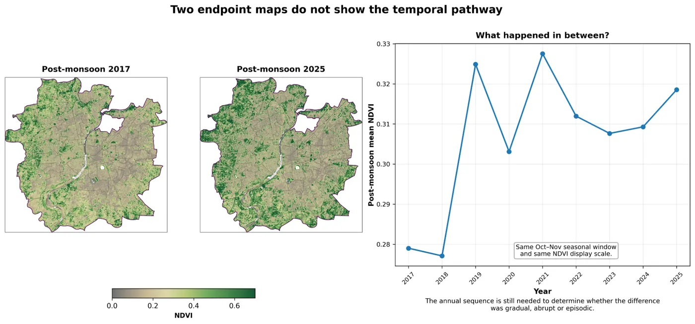
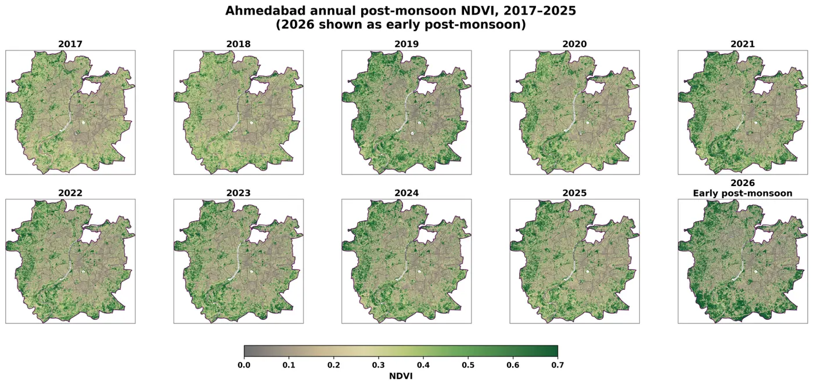
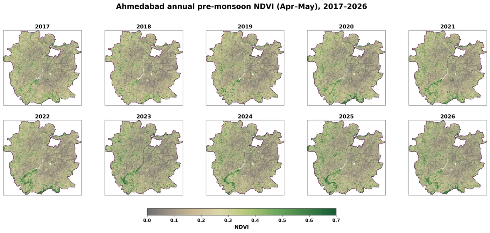
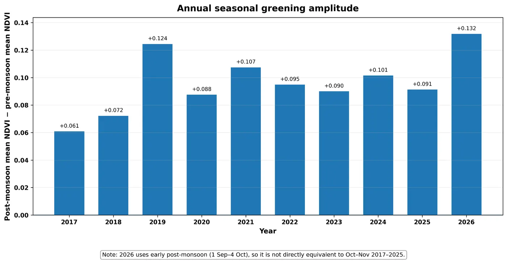

::: {.panel .reading}
[Reading this carefully]{.panel-title}

Shows
:   Post-monsoon NDVI across Ahmedabad was higher in 2025 than in 2017, and dry-season NDVI stayed fairly stable.

Doesn’t show
:   A steady trend, or what caused the change. This is a methods illustration, not a trend test or attribution study.

Connected to
:   Rainfall and monsoon timing, crop and vegetation phenology, irrigation and soil moisture, and land-cover change from urban expansion. None were tested here; each could explain part of the signal.
:::

Recently I’ve been seeing quite a few posts where NDVI maps from two different years are placed side by side, and the difference is immediately read as improving or declining vegetation. Sometimes that change is then linked to plantation, restoration, development or degradation.

There is nothing wrong with comparing NDVI between two periods. The problem begins when the comparison itself becomes the conclusion. A higher NDVI in the second image does not automatically mean permanent vegetation gain, and a lower one does not necessarily mean loss.

## Questions to ask before reading two maps

- Were both images acquired in the same season?
- Are they single-date scenes, monthly, seasonal or annual composites?
- Were the sensor, masking, resolution and colour scale the same?
- Were rainfall and moisture conditions comparable?
- And the one that is easiest to miss: what happened in the years between them?

{fig-alt="Left: post-monsoon NDVI maps of Ahmedabad for 2017 and 2025. Right: line chart of post-monsoon mean NDVI from 2017 to 2025, rising sharply in 2019, dropping in 2020, rising in 2021, then easing before rising again in 2025."}

If I compare only post-monsoon NDVI from 2017 and 2025, 2025 clearly looks greener. If those were the only two images shown, it would be easy to call this an increase in vegetation over time.

Once the intervening years are added, the picture changes. Post-monsoon NDVI rose sharply in 2019, dropped in 2020, rose again in 2021, eased over the following years and rose again by 2025. The endpoint difference is real, but the pathway was not a smooth increase.

## Seasonality complicates it further

In the same series, pre-monsoon NDVI stayed comparatively stable while post-monsoon NDVI varied much more from year to year. Compare unmatched seasonal windows, or choose dates without thinking about rainfall and phenology, and the apparent change can look very different from the longer pattern.

{fig-alt="Ten small maps of Ahmedabad post-monsoon NDVI for 2017 to 2026, with visibly varying greenness from year to year."}

{fig-alt="Ten small maps of Ahmedabad pre-monsoon NDVI for 2017 to 2026, looking broadly similar across years."}

{fig-alt="Bar chart of post-minus-pre monsoon mean NDVI by year, ranging from 0.061 in 2017 to 0.132 in 2026."}

> Two NDVI maps can both be correct while the story built from them is incomplete.

For researchers and students the practical lesson is simple: compare like with like, keep the processing consistent, and if the argument is about change over time, look at the years in between.

For planners and decision-makers shown before-and-after NDVI maps, two questions go a long way. Were these images actually comparable? And what happened in between?

One of the great strengths of remote sensing is repeated observation of the same landscape over time. It seems wasteful to have that time series and then reduce the interpretation to two convenient snapshots.

## Method

::: {.method}
Data
:   Sentinel-2 Level-2A surface reflectance

Processing
:   Google Earth Engine: cloud and SCL masking, annual seasonal composites

Season windows
:   Pre-monsoon April–May; post-monsoon October–November; 2026 as early post-monsoon

Display
:   Python: identical extent, NDVI scale 0.0–0.7, same palette and styling

Code
:   Available on request
:::

::: {.discuss-lead}
## How do you handle this?

I’d like to hear how others approach NDVI comparisons, especially when maps are used to support project or policy conclusions.
:::
