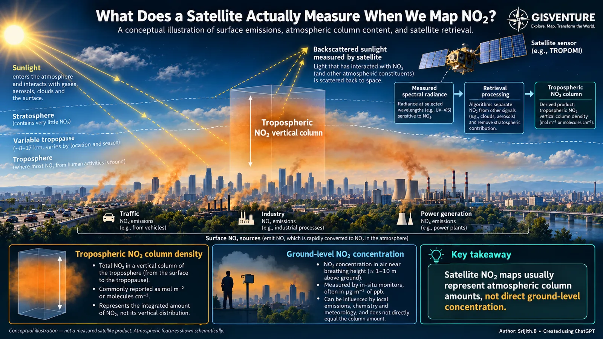

::: {.panel .reading}
[Reading this carefully]{.panel-title}

Shows
:   Tropospheric NO₂ vertical column density: the total amount in a column from the surface to the tropopause.

Doesn’t show
:   How that NO₂ is distributed vertically, or what people breathe at street level.

Connected to
:   Emission sources (traffic, industry, power generation), wind and vertical mixing, photochemistry, and meteorology. Together they set how a column amount relates to air at street level.
:::

Satellite observations are widely used to study atmospheric pollutants over large areas. One of them is nitrogen dioxide, commonly associated with traffic, industry and power generation. With TROPOMI on Sentinel-5P we can map NO₂ over cities, industrial regions and whole countries.

But what exactly are we measuring?

Looking at a satellite NO₂ map, it is easy to assume the values are concentrations near the ground, like those from an air quality monitor. They are not. TROPOMI observes sunlight that has interacted with the atmosphere and surface. Retrieval algorithms use that spectral information to estimate the NO₂ in the atmospheric column. For tropospheric products, the result is a vertical column density, usually in molecules/cm² or mol/m², not a concentration at a given height.

{fig-alt="Illustration of a city with traffic, industry and power plants emitting NOx, an orange column of tropospheric NO2 above it, sunlight scattering back to a satellite, and panels contrasting column density with ground-level concentration."}

## Why the distinction matters

NO₂ depends on emissions, but also on wind, mixing, chemistry and weather. Two places can have similar column amounts but different near-surface concentrations, depending on how the gas is distributed vertically. A higher column does not automatically mean proportionally worse air at breathing height.

Satellite data is still extremely valuable for regional patterns, changes over time and likely emission hotspots, especially where ground monitors are sparse. Understanding near-surface air quality needs more: ground observations, meteorology and, depending on the question, atmospheric models.

Before interpreting a satellite map, know what the values represent.
