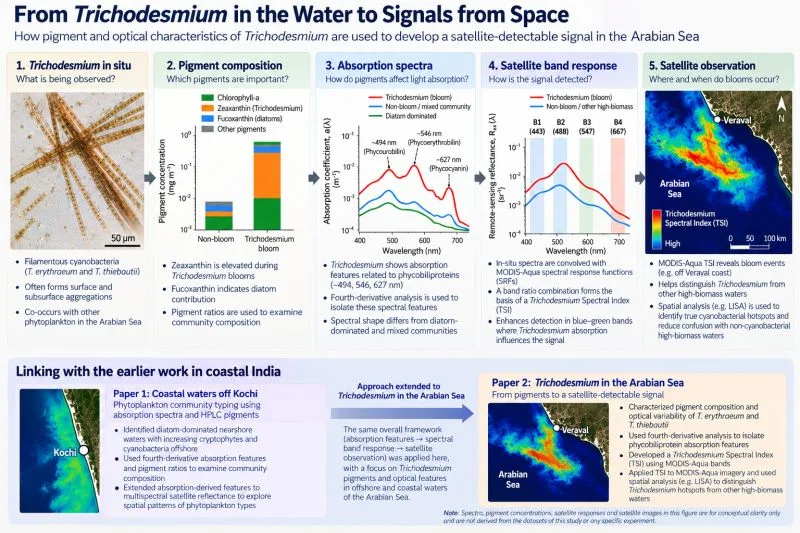

::: {.panel .reading}
[Reading this carefully]{.panel-title}

Shows
:   Which absorption-guided spectral relationships survive from hyperspectral to multispectral resolution, and how a Trichodesmium Spectral Index (TSI) behaves spatially.

Doesn’t show
:   Bloom detection from a single absorption feature. Mixed communities, varying biomass and coastal optics all complicate the signal.

Connected to
:   Mixed phytoplankton communities, wide variation in biomass, and the optical complexity of coastal waters. Each can blur or mimic the bloom signal.
:::

Our earlier work on phytoplankton typing off Kochi started with a simple question: can pigment-related features in absorption spectra still carry useful information when we move to satellite observations? That work combined microscopy, HPLC pigments, phytoplankton absorption and satellite reflectance. Fourth-derivative absorption analysis identified spectral features linked to changes in community composition, which we then explored at multispectral satellite resolution.

In our more recent work we applied that absorption-guided approach to Trichodesmium blooms in the Arabian Sea.

Here the problem was more specific. Trichodesmium has characteristic phycobiliprotein absorption, but detecting a bloom from space is not just a matter of finding one feature. Natural waters hold mixed communities, biomass varies widely, and coastal waters add optical complexity.

So we followed the signal through several stages: field-observed blooms, pigment composition, phytoplankton absorption, hyperspectral reflectance, MODIS-Aqua bands, and finally satellite-scale spatial patterns. Hyperspectral observations were convolved with MODIS-Aqua spectral response functions, and the relationships still detectable at multispectral resolution were used to build the TSI. We then compared its spatial behaviour with chlorophyll-a and used spatial analysis to distinguish cyanobacterial hotspots from other high-biomass waters.

{fig-alt="Five-panel workflow from microscope image of Trichodesmium, to pigment bar chart, absorption spectra, band response and a satellite map of the Arabian Sea, with a lower panel linking earlier work off Kochi."}

**Paper:** Optical variability of *Trichodesmium erythraeum* and *T. thiebautii* blooms in the Arabian Sea: from pigments to satellite signals. *Remote Sensing Applications: Society and Environment* 43, 102251 (2026). [doi:10.1016/j.rsase.2026.102251](https://doi.org/10.1016/j.rsase.2026.102251)
