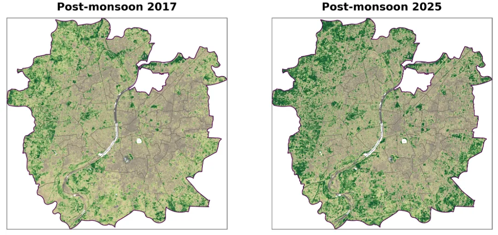

:::::: {.home}

```{=html}
<section class="hero">
  <div>
    <h1>Work worth building on.</h1>
    <p><strong>I’m Srijith Balan, a remote sensing and GIS researcher.</strong></p>
    <p>Every piece of research becomes someone’s foundation, so I try to show all of it: the method, the context, and the result, whether it worked or not. Here you’ll find my published research, consulting work and tools, and smaller explorations that ask what polished maps and reports leave out. No environmental change happens in isolation.</p>
  </div>
  <figure>
    
    <figcaption><b>Post-monsoon NDVI over Ahmedabad, 2017 and 2025.</b> The difference is real. Whether it means anything depends on the years in between. <a href="gisventure/ndvi-endpoints/index.html">Read the exploration</a></figcaption>
  </figure>
</section>
```

:::: {.block}
## Recent explorations

::: {.block-lead}
Short studies from GISVENTURE, my exploration lab. Each one states what the data supports, where it stops, and what it connects to. [See all explorations](gisventure/index.qmd)
:::

::: {#home-explorations}
:::
::::

:::: {.block .papers}
## Published research

::: {.block-lead}
Ocean optics, phytoplankton and coastal dynamics. [All publications](research.qmd)
:::

- Optical variability of *Trichodesmium erythraeum* and *T. thiebautii* blooms in the Arabian Sea: from pigments to satellite signals [Remote Sensing Applications: Society and Environment, 2026]{.v}
- Expansion of low-chlorophyll regions in the tropical Indian Ocean: spatial patterns and physical–biogeochemical associations [Marine and Freshwater Research, 2026]{.v}
- Linking derivative absorption spectra and HPLC pigments to satellite observations for phytoplankton typing in coastal India [Journal of the Indian Society of Remote Sensing, 2026]{.v}
::::

:::: {.block .split}
::: {.plain}
## Projects

Applied work for restoration programmes, NGOs and researchers.

- **Mangrove restoration, coastal Gujarat.** Two decades of restoration outcomes read by planting phase, and a radar-based baseline for the next phase, with VIKAS Centre for Development.
- **Brine outfall siting.** Seasonal 2D hydrodynamic modelling on an arid coastal mudflat.
- **[CartoZen](cartozen.qmd).** A publication-ready map generator for scientists and fieldworkers, usable right on this site.

[More projects](projects.qmd)
:::

::: {.plain}
## Mentoring

Before remote sensing, I taught physics for a decade. I still mentor young learners, on more than academics.

- **Beyond the Bell: Rethinking Schools**, a podcast on school beyond grades. Episode 1: *What an Ideal School Should Be*.
- [Conflicts: not an obstruction but a learning curve](mentoring/conflicts-learning-curve/index.qmd)
- [Troublemakers? Yes. But why?!](mentoring/troublemakers/index.qmd)

[Writing and podcast](mentoring/index.qmd)
:::
::::

```{=html}
<section class="signup" aria-labelledby="nl-title">
  <div>
    <h2 id="nl-title">Get new explorations by email</h2>
    <p>Roughly twice a month. One piece of data, read carefully, and a question for you.</p>
  </div>
  <form action="https://buttondown.com/api/emails/embed-subscribe/srijithbalan" method="post" target="popupwindow">
    <label for="nl-email" class="visually-hidden">Email address</label>
    <input type="email" name="email" id="nl-email" placeholder="you@example.com" autocomplete="email" required>
    <button type="submit">Subscribe</button>
  </form>
</section>
```

::::::
