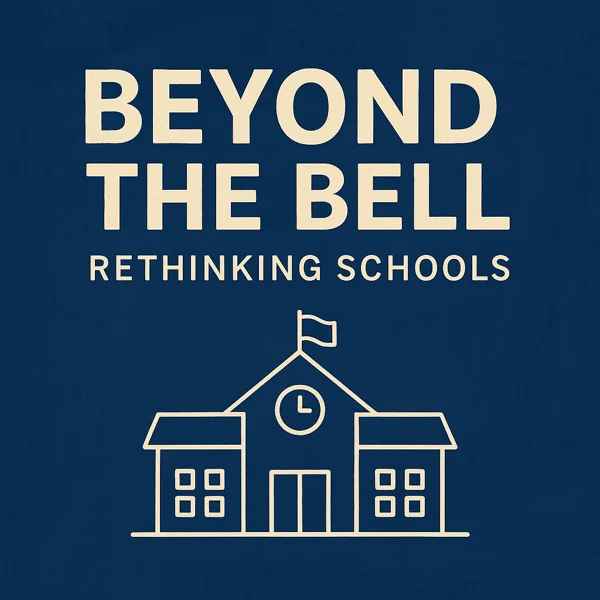

## Beyond the Bell: Rethinking Schools

```{=html}
<section class="podcast">
  
  <div>
    <p>A podcast that looks at schools from the outside, at how children develop as whole people. The aim is to move the conversation beyond grades, to emotions, empathy and civic sense.</p>
    <h3>Episode 1: What an Ideal School Should Be</h3>
    <p class="ep-topics">Misplaced priorities, emotional vocabulary, communication boundaries, empathy and consent, civic and moral sense, a thought experiment, and a call to action.</p>
    <audio controls preload="metadata">
      <source src="beyond-the-bell-ep1.mp3" type="audio/mpeg">
      Your browser can’t play this audio. <a href="beyond-the-bell-ep1.mp3">Download the episode (MP3)</a>.
    </audio>
  </div>
</section>
```

## Writing on teaching and growing up

Most of these were first published on LinkedIn. The 2025 pieces form a loose series on empathy in the classroom: practical reflections I wish someone had handed me while I was still in the thick of teaching.

::: {#writing-list}
:::
