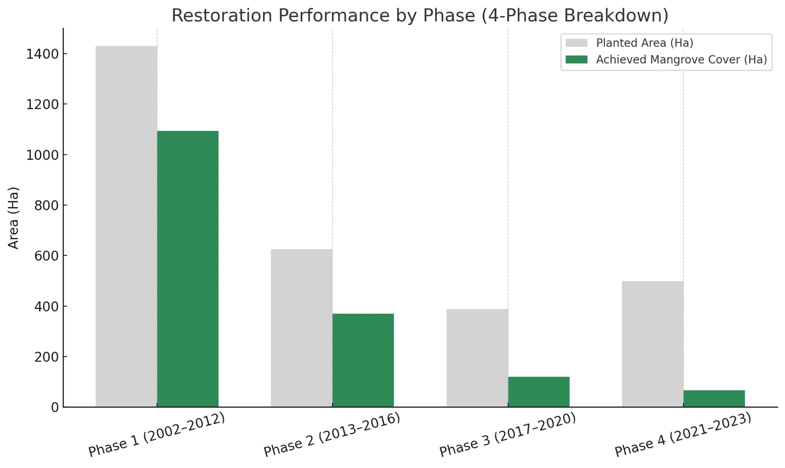
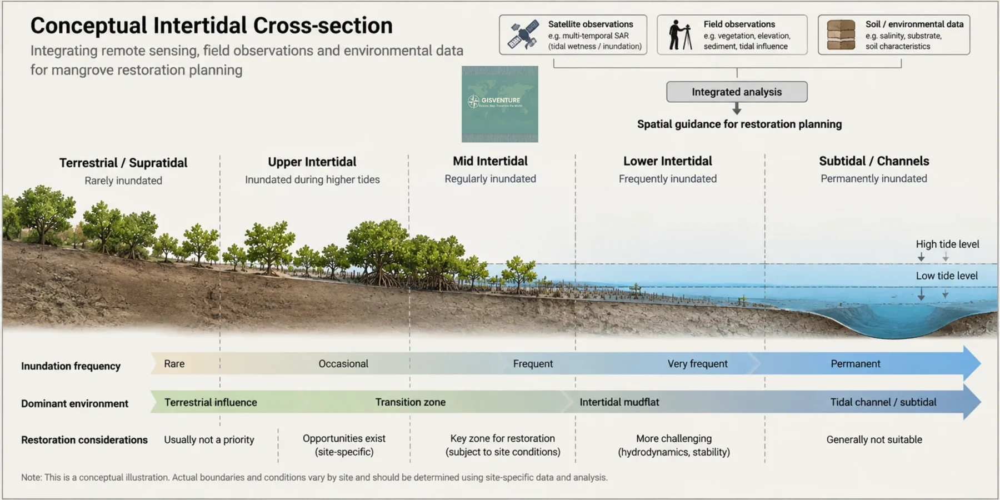
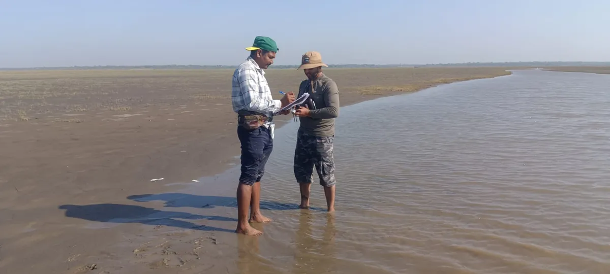
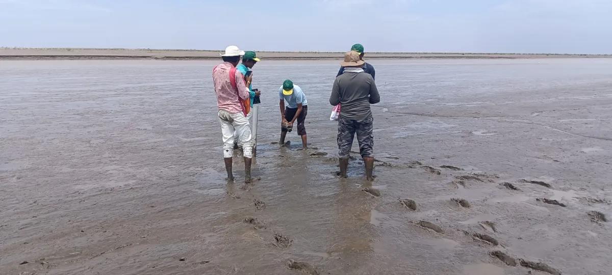
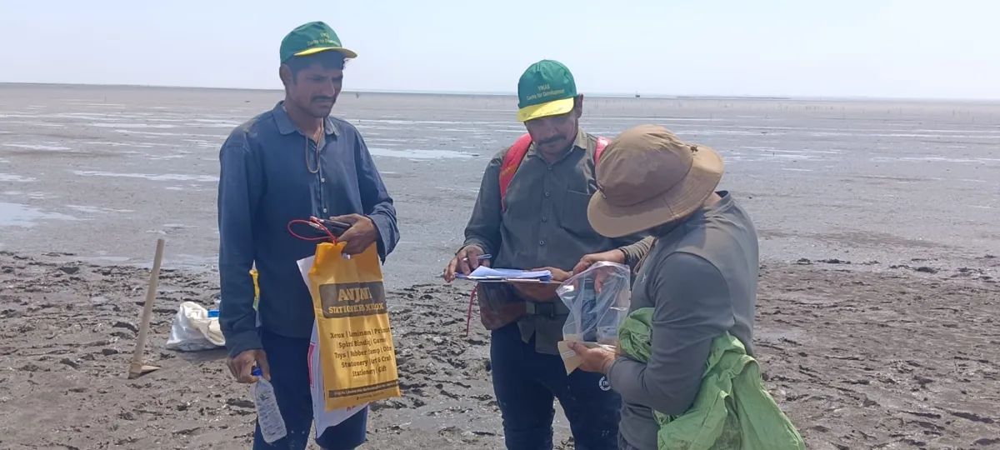
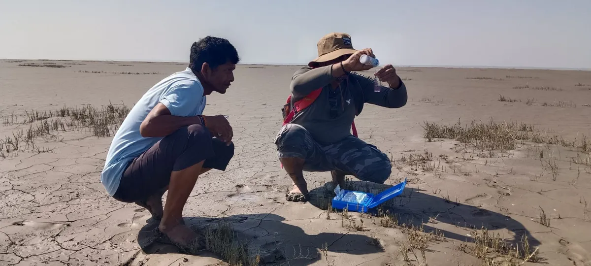
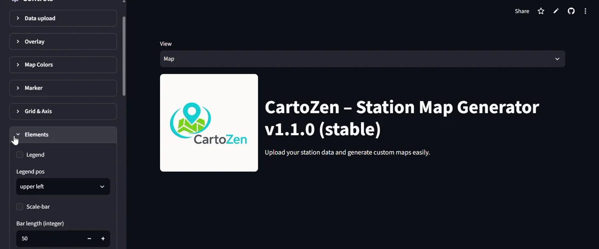

## Mangrove restoration, Gujarat coast

*With VIKAS Centre for Development, 2025 to present*

Two strands of work support a long-running, community-based mangrove restoration programme on the Gujarat coast: looking back at what two decades of planting achieved, and building the baseline for the next phase.

### Two decades of restoration on the Bharuch coast, 2000–2024

An independent GIS assessment of restoration carried out in four phases: 2002–2012, 2013–2016, 2017–2020 and 2021–2023. The planted area was mapped as 59 polygon units across 30 regions, so that each could be tracked over time.

::: {.method}
Imagery
:   Landsat 7 for the pre-restoration baseline (2000); Sentinel-2 for 2015, 2018, 2021 and 2024

Indices
:   NDVI, OSAVI and EVI for vegetation condition and density classes; NDSI for surface salinity trends

Analyses
:   Change detection, area by density class, carbon sequestration estimates, shoreline change and salinity transects
:::

About 2,900 hectares were brought under plantation. By 2024, about 1,650 hectares, roughly 57%, showed mangrove cover detectable from space: 752 ha dense, 628 ha moderate and 271 ha sparse.

That 57% is easy to misread. It does not mean the other 43% died. Mangroves take years to grow large and dense enough to stand out from the surrounding mudflat in 10 m Sentinel-2 pixels, and much of the area was planted recently. Splitting the result by phase makes this visible: detected cover is about 77% of the planted area for 2002–2012, 59% for 2013–2016, 31% for 2017–2020, and 13% for 2021–2023.

{fig-alt="Bar chart comparing planted area and achieved mangrove cover for four phases. Phase 1 (2002–2012): about 1,430 ha planted, 1,100 ha cover. Phase 2 (2013–2016): about 625 ha planted, 370 ha cover. Phase 3 (2017–2020): about 390 ha planted, 120 ha cover. Phase 4 (2021–2023): about 500 ha planted, 65 ha cover."}

The steady decline with younger phases fits growth time rather than failure, although stress from salinity, stagnation or poor tidal access also plays a part at some sites. The two cannot be fully separated from space. Reporting planted area, detected cover and planting age together is the point: the first is effort, the second is what the satellite can confirm, and the third explains much of the gap.

::: {.panel .reading}
[Reading this carefully]{.panel-title}

Shows
:   Where planted areas have developed mangrove cover, at what density, and how cover, surface salinity and the shoreline changed between 2000 and 2024.

Doesn’t show
:   Mortality. Undetected area is not dead area: young plantations are often too small or sparse to resolve at 10 m. Field survival counts are needed for that. Carbon figures are model-based estimates, and NDSI tracks a surface spectral signal, not measured soil salinity.

Connected to
:   Planting age and growth rate, tidal access and drainage, salinity, salt pan expansion along the coast, and industrial land use nearby.
:::

### Baseline for a new restoration phase, Gulf of Khambhat, 2026

For the Khambhat Mangrove Restoration Project, before large-scale planting at three new sites on the Bharuch coast (Tadatalav, Bajipura and Ralej), the question was where saplings could survive and where field teams could work safely. Public elevation data cannot resolve the few centimetres that decide whether water drains or stagnates on these mudflats, so the baseline tracked water behaviour directly.

{fig-alt="Illustrated cross-section from land to tidal channel in five zones: terrestrial or supratidal (rarely inundated, usually not a restoration priority), upper intertidal (inundated at higher tides, site-specific opportunities), mid intertidal (regularly inundated, key zone for restoration subject to site conditions), lower intertidal (frequently inundated, more challenging) and subtidal channels (permanently inundated, generally not suitable). Boxes at the top show satellite, field and soil data feeding an integrated analysis."}

**Approach.** A two-year Sentinel-1 radar time series was used to map how often each part of the mudflats holds water, separating active tidal channels, stable corridors and stagnant depressions. Field verification checked those patterns on the ground, along with mud stability and safe access, and drew on local knowledge of seasonal access and channel changes; coastal residents provided tractors to cross unstable mud. Soil cores were analysed in a laboratory.

**A negative result that changed the plan.** Portable field probes suggested moderate salinity and patches of acidic soil. Laboratory analysis corrected both: the soils were alkaline throughout, and salinity in stagnant basins and on higher ground was far higher than the probes indicated, at levels that stress young mangroves severely. Field readings had been distorted by waterlogged, mineral-rich mud. Planting decisions based on the probes alone would have put saplings into soil likely to kill them.

The three sites turned out to be three different systems a few kilometres apart: Tadatalav, a well-flushed mudflat with lower salinity but deep, fluid mud; Bajipura, a trapped basin with firm but highly saline ground; and Ralej, a raised platform where conditions change sharply with elevation.

The recommendations moved away from uniform planting: restore drainage before planting in stagnant areas, cluster work in verified stable corridors, shift towards mixed species, and set worker-safety protocols for unstable mud. A post-monsoon reassessment is built into the plan.

*The detailed methods and results may be published, so this summary leaves out specific thresholds and values.*

::: {.panel .reading}
[Reading this carefully]{.panel-title}

Shows
:   How often each part of the sites is wet, where conditions are stable enough to plant and walk, and laboratory-verified soil conditions at sampled points.

Doesn’t show
:   Elevation itself, conditions during the monsoon, or sapling survival. The radar record covers two years, and soil chemistry is known only where cores were taken.

Connected to
:   Tidal flushing and channel siltation, evaporation, livestock grazing, and community use of the mudflats.
:::

::: {layout-ncol=2 .field-gallery}
{fig-alt="Two field team members standing at the edge of a shallow tidal channel on a wide mudflat, one writing on a clipboard."}

{fig-alt="A group of field workers on a wet mudflat, one bending to extract a soil core while others watch and record."}

{fig-alt="Three people on a mudflat, two in VIKAS Centre for Development caps, checking a clipboard and a bagged sample."}

{fig-alt="Two people crouching on dry, cracked mud with sparse salt-tolerant plants, one holding up a test vial from an open field kit."}
:::

*Field verification, February–March 2026.*

## Brine outfall siting on an arid coastal mudflat

*Hydrodynamic assessment for an industrial client, western India, 2026*

A proposed treatment plant needed a location to discharge brine onto a hyper-arid coastal mudflat without the effluent reaching a nearby embankment or salt-working areas, now or across the seasons. The task was to find where the water would go, and whether it would stay there.

::: {.method}
Field survey
:   DGPS micro-elevation transects, soil cores and in-situ conductivity. The site is clay-rich, hypersaline, salt-crusted and almost impermeable, with less than half a metre of relief across the area.

Terrain
:   ALOS AW3D30 surface model, cleaned and conditioned in Google Earth Engine

Model
:   HEC-RAS 2D on a 30 m mesh. The diffusion-wave solver was chosen after a control run showed results matching the full shallow-water equations in this friction-dominated, slow-flow setting. A 10 m mesh captured finer channels but became numerically unstable over a full year.

Forcing
:   13 months of daily CHIRPS rainfall and ERA5-Land evapotranspiration (February 2025 to February 2026)

Design load
:   Discharge set 50% above the maximum design capacity, pulsed to mimic operating and maintenance cycles
:::

**Siting.** A worst-case run with no rainfall and no evaporation showed the effluent stays confined to natural micro-channels, so subtle topography controls where it goes. Five candidate outfall points were then tested. Four routed effluent towards the embankment. One, about 600 m from the original proposal, sits behind a micro-divide only tens of centimetres high that stops westward flow and sends the discharge down an eastward gradient, away from both sensitive areas.

**Seasonal behaviour at the chosen point.** In the dry season, evaporation balances the discharge and the wetted area stays within local channels. During the monsoon, regional flooding submerges the outfall entirely; water levels rise under constant inflow, which shows the regional flood, not the discharge, controls levels then. After the monsoon, evaporation removes the standing water, and by late winter the footprint returns to its dry-season extent with no carry-over to the next year.

**Recommendations** included passive relief drains for extreme monsoon ponding, contingency relief wells, and a monitoring plan (drone surveys, salinity measurements and post-monsoon inundation mapping) so field behaviour can be checked against the model.

::: {.panel .reading}
[Reading this carefully]{.panel-title}

Shows
:   Where discharged water flows and pools across a full seasonal cycle, under conservative loading, and which outfall location keeps it away from sensitive areas.

Doesn’t show
:   Salinity transport, density-driven mixing between brine and floodwater, or wind-driven spreading. Terrain is held static, so post-monsoon reshaping and features smaller than 30 m are not captured.

Connected to
:   Monsoon rainfall and regional flooding, evaporation, micro-topography, and future changes to the surrounding land use.
:::

## CartoZen

A lightweight, browser-based station map generator for research, teaching and reporting. Upload station coordinates from a spreadsheet, add overlays, and export a publication-ready map with legend, scale bar, north arrow and inset, at up to 600 DPI. Nothing to install.

{fig-alt="Screenshot of the CartoZen app: a dark sidebar of collapsible control sections (Data upload, Overlay, Map Colors, Marker, Grid and Axis, Elements) beside the CartoZen logo and the title Station Map Generator v1.1.0."}

[Features, walkthrough video and the app itself](cartozen.qmd), or [open CartoZen in its own tab](https://cartozenv1.streamlit.app/).

## Earlier work

**National Institute of Oceanography, Kochi (2013–2017).** As a Project Assistant, I worked on coastal hydrodynamic modelling of Vembanad Lake, mud bank formation along the Kerala coast, and related field and laboratory studies. See [Research](research.qmd).

**M.Phil. dissertation, 2013.** For my M.Phil. in Ecological Informatics at IIITM-K, Thiruvananthapuram, I carried out the dissertation at ATREE, Bangalore. It assessed the impact of urbanisation on wetlands in Kochi Corporation and surrounding panchayats between 1990 and 2010, using Landsat TM and IRS LISS-III imagery, normalised difference indices and a test index developed to separate built-up from barren land. The classifications reached 85% and 92% overall accuracy. Built-up area increased and wetland area decreased in every panchayat studied.
